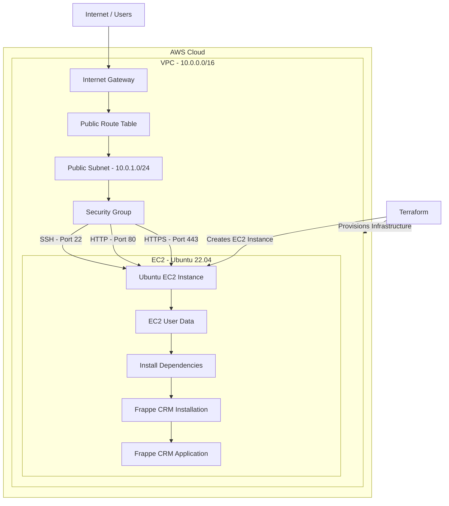

# Frappe CRM – AWS Architecture

## Architecture Diagram

## AWS Components

| Component | Description |
|---|---|
| Terraform | Infrastructure provisioning |
| VPC | Isolated AWS network |
| Public Subnet | Hosts the EC2 instance |
| Internet Gateway | Provides internet connectivity |
| Route Table | Routes internet-bound traffic |
| Security Group | Controls inbound and outbound traffic |
| EC2 | Runs the Frappe CRM installation |
| Ubuntu 22.04 | Operating system |
| EBS | 30 GB gp3 root volume |
| EC2 User Data | Automates initial installation |
| Frappe CRM | Application deployed on EC2 |

## Network Configuration

| Port | Protocol | Purpose |
|---|---|---|
| 22 | TCP | SSH access (restricted IP) |
| 80 | TCP | HTTP access |
| 443 | TCP | HTTPS access |

## Deployment Workflow

1. Terraform initializes the AWS provider.
2. Terraform provisions the VPC and networking components.
3. Terraform creates the security group.
4. Terraform launches the Ubuntu EC2 instance.
5. EC2 User Data executes the installation script.
6. The installation script configures Frappe CRM.

## Technologies Used

- AWS EC2
- AWS VPC
- AWS Security Groups
- Ubuntu 22.04
- Terraform
- Docker-based Frappe CRM installation

